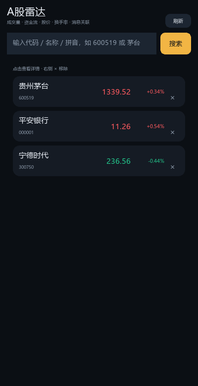
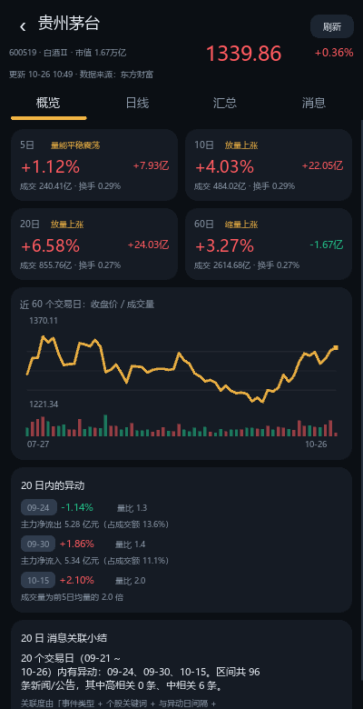
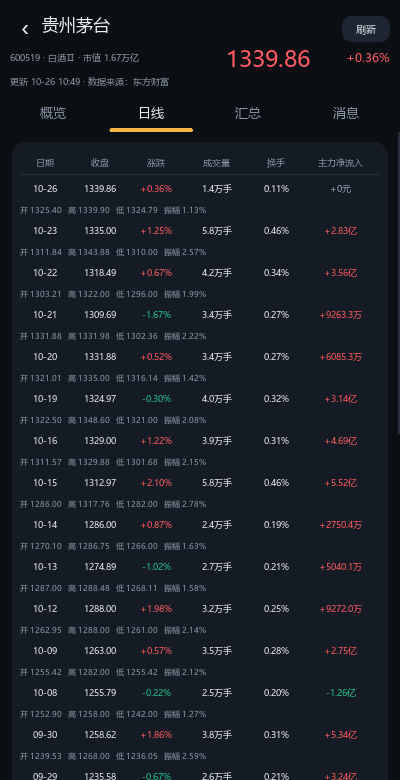
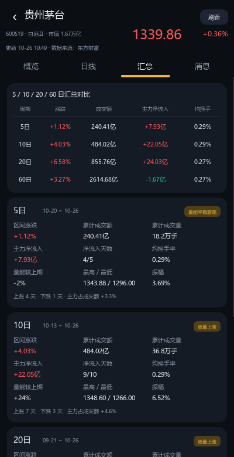
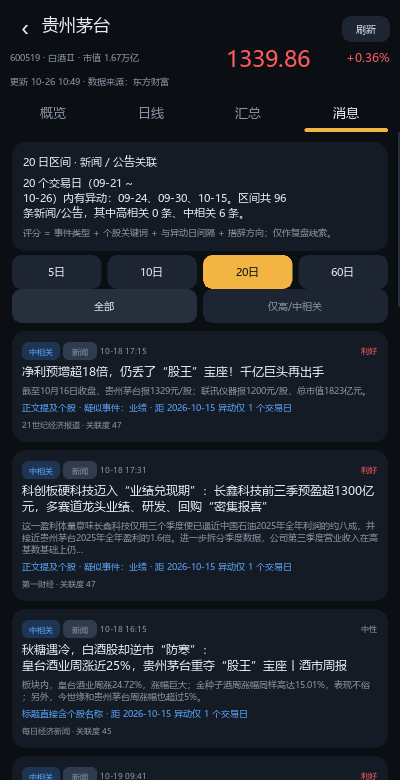

# A股雷达 StockLens

用 **Python + Kivy** 写的 A 股个股观察 App：看每天的量价与资金进出，自动汇总 **5 / 10 / 20 / 60 日** 数据，
并把这段时间的**新闻、公告**和股价异动放在一起对照，给出**可能的关联**线索。

* 可打包成 **安卓 APK** 安装到手机（`buildozer`，含 GitHub Actions 一键打包）
* 也能直接在 **Windows / macOS / Linux** 上运行（同一套代码，方便先看效果）
* 纯 Python 标准库访问数据接口，安装包只依赖 Kivy，不需要 pandas / akshare

| 自选股 | 概览（汇总 + 走势 + 异动） |
| --- | --- |
|  |  |

| 日线明细 | 5/10/20/60 日汇总 | 新闻公告关联 |
| --- | --- | --- |
|  |  |  |

> 截图来自 Windows 预览版（400×780），手机上会自动适配屏宽。

---

## 1. 功能

### 自选股
* 输入 **代码 / 名称 / 拼音** 搜索（如 `600519`、`茅台`、`gzmt`），结果可直接加入自选
* 自选列表显示最新价与涨跌幅（红涨绿跌），点开看详情，右侧 `×` 移除
* 自选股保存在本机，随时可用

### 日线明细（每天两行）
| 行 | 内容 |
| --- | --- |
| 第一行 | 日期 / 收盘 / 涨跌 / 成交量（万手）/ 换手率 / 主力净流入 |
| 第二行 | 开盘 / 最高 / 最低 / 振幅 |

同时抓取并保存：成交额、超大单/大单/中单/小单净流入，供汇总页计算。

### 5 / 10 / 20 / 60 日汇总
每个周期一张卡片，方便横向对比：

* 区间涨跌幅、区间最高/最低、振幅
* 累计成交额、累计成交量
* **主力净流入合计**、净流入天数、主力占成交额比例
* 平均换手率
* **量能较上期**（日均成交量相对上一个同长度区间）
* 一句话标签：放量上涨 / 缩量震荡 …

顶部还有一张对比表，四个周期一眼看完。

### 异动识别
在所选周期内自动标出“值得看一眼”的交易日：

* 涨跌幅 ≥ 3%
* 成交量为前 5 日均量的 1.8 倍以上（放量）
* 换手率 ≥ 5% 且达到前 10 日均值 2 倍
* 主力资金净流入/流出显著偏离常态

### 新闻 / 公告关联
* 自动抓取个股近 120 天的财经新闻与公司公告
* 与异动日做**时间 + 内容**匹配，给出 0–100 的关联度和“高/中/低”等级
* 每条都写明理由，例如：`标题直接含个股名称`、`距 2026-10-15 异动仅 1 个交易日`、`疑似事件：业绩`
* 可按 5/10/20/60 日切换查看区间，并可只看高/中相关
* 点击卡片在浏览器中打开原文（安卓调用系统 Intent）

> 关联度是启发式打分（关键词 + 时间邻近 + 事件类型 + 措辞方向），用来**快速定位线索**，
> 不是因果关系，也不构成投资建议。

### 其他
* 所有请求结果本地缓存（10 分钟 ~ 1 小时），**断网时自动回退上次数据**并在页面提示
* 后台线程加载，界面不卡；支持下拉式“加载更多”
* 深色主题、涨红跌绿，手机竖屏适配

---

## 2. 在电脑上直接运行（推荐先这样看效果）

需要 Python **3.9–3.13**（Kivy 2.3.1 目前还没有 Python 3.14 的预编译包）。

```bash
cd a_stock_radar
python -m venv .venv
# Windows
.venv\Scripts\activate
# macOS / Linux
source .venv/bin/activate

pip install kivy pillow
python main.py
```

如果电脑默认 Python 是 3.14，用 3.12 建虚拟环境即可：

```powershell
py -3.12 -m venv .venv        # Windows（已装 3.12 时）
# 或使用 uv：
uv venv --python 3.12 .venv
```

窗口默认 400×780，和手机比例接近。数据直接来自东方财富公开接口，**需要联网**。

> 电脑上如果中文显示成方块，说明系统没有找到中文字体：
> 执行 `python tools/fetch_font.py` 下载 Noto Sans CJK，或确认 `C:/Windows/Fonts/msyh.ttc` 存在。

---

## 3. 打包成安卓 APK

安卓包不能直接在 Windows 上编译（需要 Linux 工具链）。三种方式任选：

### 方式一：GitHub Actions（最省事，不用装环境）

1. 把 `a_stock_radar` 整个目录推到一个 GitHub 仓库（保持 `buildozer.spec` 在仓库根目录）；
2. 仓库 **Actions → Build Android APK → Run workflow**；
3. 构建约 20–40 分钟，完成后在该次运行页面底部 **Artifacts** 下载 `stocklens-debug-apk`（里面是 `*.apk`）；
4. 传到手机安装（需允许“安装未知来源应用”）。

工作流文件：`.github/workflows/android.yml`。

### 方式二：Docker（本机有 Docker 即可，不用装 Android SDK）

```bash
docker run --rm -v "$PWD":/home/user/hostcwd kivy/buildozer:latest android debug
```

在 `a_stock_radar` 目录下执行，产物在 `bin/`。

### 方式三：WSL2 / Ubuntu 本地构建

```bash
sudo apt update
sudo apt install -y git zip unzip openjdk-17-jdk python3-pip \
    autoconf libtool pkg-config zlib1g-dev libncurses-dev libtinfo6 \
    cmake libffi-dev libssl-dev
pip install buildozer cython virtualenv

cd a_stock_radar
python tools/fetch_font.py     # 下载中文字体（必须，否则界面是方块）
buildozer -v android debug     # 首次会下载 Android SDK/NDK，约 3~6 GB
```

产物：`bin/stocklens-1.0.0-arm64-v8a-debug.apk`。

安装：

```bash
adb install -r bin/stocklens-*-debug.apk
```

### 打包要点

* **字体**：`assets/fonts/` 下必须有中文字体（`tools/fetch_font.py` 会下载 Noto Sans CJK；
  下载失败时会自动复制系统字体，Ubuntu 可先 `sudo apt install fonts-noto-cjk`），
  否则界面中文会变成方块；`buildozer.spec` 已把 `.otf/.ttc` 加进打包范围。
* **依赖**：`python3, kivy==2.3.1, certifi`。`certifi` 提供 HTTPS 根证书（安卓系统路径不可靠）。
* **架构**：默认只出 `arm64-v8a`（现在的手机基本都是）。需要兼容老机型时，把 `buildozer.spec` 里的
  `android.archs` 改成 `arm64-v8a, armeabi-v7a`，构建时间会翻倍。
* **正式包**：`buildozer android release` 并用你自己的 keystore 签名；debug 包已经可以直接装。
* 首次构建很慢（下载 SDK/NDK + 编译 Python），之后有缓存会快很多。

---

## 4. 使用说明

1. 顶部输入框输入代码/名称/拼音 → 点“搜索” → 选中的股票自动加入自选并打开详情；
2. 详情页四个标签：
   * **概览**：4 个周期卡片、60 日走势图（收盘价 + 成交量）、区间异动、消息小结；
   * **日线**：每日量价与主力资金明细，可“加载更多”；
   * **汇总**：5/10/20/60 日对比表 + 每个周期的完整指标卡；
   * **消息**：新闻/公告列表，按关联度排序，切换周期或只看高/中相关；
3. 右上角“刷新”强制重新拉取数据（忽略缓存）；
4. 左上角 `‹` 或手机返回键回到自选列表。

---

## 5. 数据口径

数据来源：**东方财富**公开网页接口（非官方 API，可能调整或限频）。

| 指标 | 单位 | 说明 |
| --- | --- | --- |
| 开盘/最高/最低/收盘 | 元 | 日线为**前复权**价格 |
| 成交量 | 手 | 1 手 = 100 股；展示时 ≥1 万手折算为“万手” |
| 成交额 | 元 | 展示时折算为“万/亿” |
| 换手率 | % | 接口直接给出 |
| 振幅 | % | 接口直接给出（(最高-最低)/昨收） |
| 主力净流入 | 元 | 超大单 + 大单净流入；正值流入、负值流出 |
| 区间涨跌 | % | 区间最后一天收盘 ÷ 区间前一日收盘 − 1（不足一天则用首日开盘） |
| 累计成交量/额 | 手 / 元 | 区间内逐日相加 |
| 平均换手率 | % | 区间内逐日算术平均 |
| 量能较上期 | % | 本期日均成交量 ÷ 上一个同长度区间的日均成交量 − 1 |
| 主力占成交额 | % | 区间主力净流入 ÷ 区间成交额 |
| 净流入天数 | 天 | 区间内主力净流入 > 0 的天数 |

说明：

* 盘中打开时，当天数据是**实时未收盘**的，收盘后自动变成最终值；
* 新股、停牌、北交所等个别标的可能没有资金流数据，界面会给出提示；
* 所有金额都在本地换算展示，接口返回的原始单位是“元”。

---

## 6. 关联度打分规则

对区间内每条新闻/公告计算 0–100 分：

| 维度 | 分值 | 说明 |
| --- | --- | --- |
| 个股关键词 | +18 / +4 | 标题直接含股票名 / 正文提及 |
| 事件类型 | 2 ~ 18 | 重组、业绩、订单、回购、增减持、监管、分红等；新闻按 0.6 折算并标“疑似” |
| 时间邻近 | 0 ~ 28 | 与最近的异动日同日 +28，隔 1 天 +22，2 天 +12，3 天 +6，4–5 天 +3 |
| 方向一致 | +8 | 标题偏利好且当日上涨（或偏利空且当日下跌） |
| 摘要信息量 | +3 | 正文摘要 ≥ 40 字 |

* ≥ 62 分：**高相关**；42–61：**中相关**；其余：**低相关**
* 同一事件被多家媒体转载时，按标题前 14 个字去重
* 页面会同时显示打分理由，方便你自己判断是否可信

**局限**：关键词匹配无法理解上下文，可能把“行业新闻里顺带提到该股”当成相关；
时间邻近也不等于因果。它适合用来缩小范围，不适合作为买卖依据。

---

## 7. 目录结构

```
a_stock_radar/
├── main.py                     # 入口（电脑运行 / 安卓打包共用）
├── buildozer.spec              # 安卓打包配置
├── stocklens/
│   ├── config.py               # 常量、目录、缓存时长
│   ├── models.py               # 数据模型（dataclass）
│   ├── net.py                  # urllib 请求 + 磁盘缓存 + 断网回退
│   ├── eastmoney.py            # 东方财富接口：行情/资金/公告/新闻/搜索
│   ├── analyzer.py             # 5/10/20/60 汇总、异动识别、关联打分
│   ├── service.py              # 多线程装配 StockSnapshot
│   ├── format.py               # 金额/成交量/百分比格式化
│   ├── store.py                # 自选股本地存储
│   ├── smoke.py                # 命令行联调脚本
│   └── ui/
│       ├── app.py              # Kivy App、页面切换、Toast
│       ├── screens.py          # 首页 + 详情页（四个标签）
│       ├── widgets.py          # 卡片、表格、走势图、标签按钮
│       └── theme.py            # 配色、中文字体注册
├── assets/                     # 图标、启动图、字体
├── tools/
│   ├── fetch_font.py           # 下载中文字体
│   └── make_icon.py            # 生成图标/启动图
├── tests/                      # 单元测试（不联网）
├── docs/screenshots/           # 界面截图
└── .github/workflows/android.yml
```

---

## 8. 开发与测试

```bash
# 单元测试（汇总算法、解析、关联打分）
python -m unittest discover -s tests -t .

# 命令行联调：真实接口 → 打印汇总与关联结果
python -m stocklens.smoke 600519
```

`stocklens.smoke` 会打印最近 6 天明细、四个周期的汇总，以及 5/20 日的异动与消息匹配，
适合在不启动界面的情况下排查接口问题。

---

## 9. 常见问题

**Q：手机上打开一片空白 / 中文全是方块？**
A：几乎都是没打包中文字体。确认 `assets/fonts/NotoSansSC-Regular.otf` 存在后重新构建
（`python tools/fetch_font.py`）。

**Q：提示“网络不稳定，部分数据来自本地缓存”？**
A：接口请求失败时回退到上次缓存。检查网络，或点“刷新”强制重取。

**Q：数据不更新 / 涨跌幅和行情软件略有差异？**
A：接口有 10 分钟缓存；涨跌幅按前复权价计算，和部分软件可能有小数点差异。

**Q：能看港股/美股/基金吗？**
A：当前只做了 A 股（沪深京）。搜索时会过滤 `AStock` 类型。

**Q：接口会不会挂？**
A：用的是东方财富网页端公开接口，可能改版或临时限频。代码里做了重试与缓存，
真挂了需要按 `stocklens/eastmoney.py` 里的 URL 更新。

**Q：打包报 `No module named 'certifi'`？**
A：把 `buildozer.spec` 的 `requirements` 改成 `python3,kivy==2.3.1`（不联网证书可能失效，
一般还是建议保留 certifi）。

---

## 10. 免责声明

本项目仅用于**学习与个人研究**，数据来自第三方公开接口，可能存在延迟、缺失或错误。
“消息关联”是算法推测，不构成任何投资建议。据此操作，风险自负。
